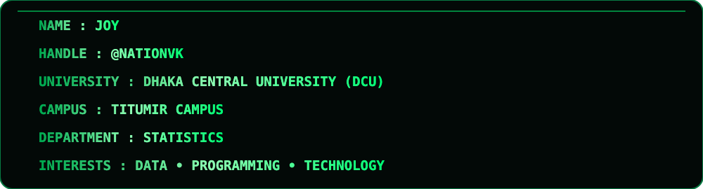

 

 

---

## [ SYSTEM PROFILE // 001 ]

### whoami

I'm **Joy (Yeasien Ahmed)** — a Statistics student at **Dhaka Central University (DCU), Titumir Campus**, exploring how data, mathematics and software can work together to solve practical problems.

I learn from the fundamentals, experiment with ideas, and build projects as a way to turn curiosity into useful skills. My development approach is **Android-first, hands-on and continuously evolving**.

> **“আমি যেমন, আমি তেমনি — আমি কোনো পরীক্ষার খাতা না।”**

| PROFILE FIELD | DETAILS |
|:--|:--|
| Identity | Joy · Yeasien Ahmed |
| Academic home | DCU · Titumir Campus · Statistics |
| Development focus | Android-first apps, web and practical tools |
| Data focus | Statistics, probability and data analysis |
| Mindset | Learn deeply · Build honestly · Improve consistently |
| Motto | **FIND YOUR OWN PATH** |

---

## [ 02 // LIVE OPERATIONS ]

| MODULE | CURRENT DIRECTION |
|:--|:--|
| STATISTICS | Probability, statistical methods and mathematical foundations |
| PYTHON | Programming fundamentals and data workflows |
| DATA LAB | Data analysis, visualization and research |
| ANDROID | Android-first application development |
| WEB SYSTEMS | HTML, CSS, JavaScript and web applications |
| CYBER LAB | Cybersecurity concepts and responsible problem-solving |

<b>▸ Open learning roadmap</b>

- Strengthen mathematics and statistical foundations.
- Practice Python through small, working projects.
- Learn data cleaning, analysis and visualization.
- Build practical Android and web applications.
- Study cybersecurity responsibly and understand systems.
- Document experiments and improve projects incrementally.

---

## [ 03 // TECHNOLOGY STACK ]

**PROGRAMMING & WEB**

  

**TOOLS & PLATFORMS**

  

**DATA & ANALYSIS**

Technology icons represent tools and areas I am exploring or using in projects; they are not a claim of expert-level proficiency.

---

## [ 04 // PROJECT SHOWCASE ]

A selection of personal builds, experiments and learning projects. Each repository is a work in progress unless its own documentation says otherwise.

<table>
<tr>
<td width="50%" valign="top">

### ◈ Galaxy
**Personal Phone Assistant**

An evolving Android assistant concept focused on a personal phone experience, voice-assistant modules and a black-hole-inspired interface.

[OPEN REPOSITORY →](https://github.com/NATIONVK/Galaxy)

</td>
<td width="50%" valign="top">

### ◈ FOCUS FLOW 4.0
**Productivity & Study System**

An Android-first productivity project for organizing tasks, focus sessions and study workflows.

[OPEN REPOSITORY →](https://github.com/NATIONVK/FOCUS-FLOW-4.0)

</td>
</tr>
<tr>
<td width="50%" valign="top">

### ◈ STATSPHERE
**Statistics Learning Space**

A project space connected to statistics, learning resources and data-focused exploration.

[OPEN REPOSITORY →](https://github.com/NATIONVK/STATSPHERE)

</td>
<td width="50%" valign="top">

### ◈ Job_Pro
**Job Preparation Project**

A job-preparation and question-bank project exploring structured learning and practice.

[OPEN REPOSITORY →](https://github.com/NATIONVK/Job_Pro)

</td>
</tr>
<tr>
<td width="50%" valign="top">

### ◈ BLUE-PARTICLE-HEART
**Creative Animation Experiment**

A visual experiment with particle effects, animated heart forms and interactive cyber-inspired motion.

[OPEN REPOSITORY →](https://github.com/NATIONVK/BLUE-PARTICLE-HEART)

</td>
<td width="50%" valign="top">

### ◈ Termux_animation
**Terminal Animation Lab**

A collection of terminal and fullscreen animation experiments built around a cyber aesthetic.

[OPEN REPOSITORY →](https://github.com/NATIONVK/Termux_animation-)

</td>
</tr>
<tr>
<td width="50%" valign="top">

### ◈ PRO-NATION-01
**Python Project**

A Python-focused repository for coding experiments and practical development.

[OPEN REPOSITORY →](https://github.com/NATIONVK/PRO-NATION-01)

</td>
<td width="50%" valign="top">

### ◈ More experiments
**Explore all repositories**

Browse other prototypes, experiments and learning projects as the development journey grows.

[VIEW ALL REPOSITORIES →](https://github.com/NATIONVK?tab=repositories)

</td>
</tr>
</table>

---

## [ 05 // GITHUB ANALYTICS ]

  

  

Analytics are generated by external services and may occasionally be delayed or unavailable due to their service limits.

---

## [ 06 // CONNECT TO NATIONVK ]

  

**Open to learning, thoughtful collaboration and useful ideas.**

---

### FIND YOUR OWN PATH

**Learn with curiosity. Build with purpose. Improve every day.**

© NATIONVK · YEASIEN AHMED · BUILT THROUGH CURIOSITY

